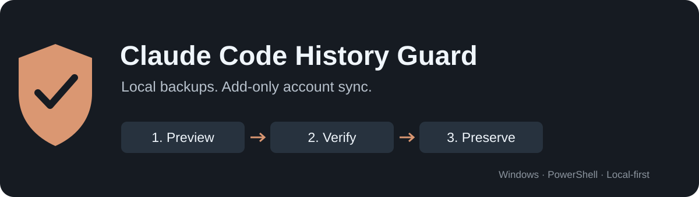

# Claude Code History Guard

**Local backups and add-only account sync for Claude Code Desktop on Windows.**

Keep local Code conversations recoverable when switching accounts. Preview what
would be copied, verify a recovery snapshot, then add only missing session files.
Existing conversations, scheduled tasks and group settings are never replaced by
the sync engine.



[Español](README.es.md) · [Quick start](#quick-start) · [Safety model](docs/safety.md) ·
[FAQ](#frequently-asked-questions) · [Contributing](CONTRIBUTING.md) · [MIT license](LICENSE)

> **Independent, experimental software.** Windows only. Fully quit Claude before
> copying. This is local Claude **Code** history, not a transfer of Claude web
> chats or an official Anthropic account migration feature. Backups reduce risk;
> no tool can promise that data loss is impossible.

## Why this exists

Code history can be present on disk while the Desktop session list is scoped to
an account and organization. This toolkit preserves those local files and makes
explicit, missing-only metadata copies between account/organization pairs you
choose. It does not change authentication or infer which accounts you own.

## What it does

| Capability | Behavior |
| --- | --- |
| Inspect and preview | Read-only discovery and a copy plan before any publication. |
| Add-only sync | Existing destinations are preserved, including conflicting copies. |
| Verified backups | SHA-256 verification, immutable file versions and completion markers. |
| Recovery drills | Restore into a new, separate folder before considering any manual recovery. |
| Optional background helper | Waits for Claude to exit, then backs up before copying new sessions. |
| Protected launcher | Completes the offline check before asking Windows to open Claude. |
| Explicit boundaries | No writes to task definitions, group settings, credentials or Claude configuration. |
| Local operation | Core backup and sync scripts make no network requests and collect no telemetry. |

The automatic helper shares **new** session names by default. It excludes names
already present when installed. Use the manual workflow for existing history.
Conversation transcript content remains in the shared local projects tree; the
sync engine adds account-scoped sidebar metadata, not a second cloud copy.

## Requirements

- Windows and local Claude Code Desktop history.
- PowerShell 7 for installation and long-path support. Core engines are also
  exercised under Windows PowerShell 5.1 with generated fixtures.
- Node.js for independent verification and repository privacy checks.
- Two or more explicitly identified account/organization scope directories.
- Enough local disk space for retained backup versions. Nothing is pruned automatically.

Install PowerShell from [Microsoft's instructions](https://learn.microsoft.com/powershell/scripting/install/installing-powershell-on-windows).
Use only accounts and conversation data you are authorized to access.

## Quick start

Download or clone this repository, open PowerShell 7 in its directory, and run the
synthetic test suite. Tests generate their own conversations and do not read your
Claude profile.

```powershell
pwsh -NoProfile -File ./Run-Tests.ps1 -Tier Quick
```

Discover candidate roots without writing to them:

```powershell
./Sync-ClaudeSessionsSafe.ps1 -Mode Inspect
```

Select the real account/organization pairs yourself. Empty directories can be
stale; do not simply choose every directory returned by Inspect. Put local paths
and account identifiers in a private file **outside this checkout**.

```powershell
# Set these from your own read-only inspection; placeholders are not runnable IDs.
$sessions = '<absolute local session root>'
$projects = Join-Path $env:USERPROFILE '.claude\projects'
$scopes = @('<account-uuid>/<organization-uuid>', '<account-uuid>/<organization-uuid>')
$backups = Join-Path $env:LOCALAPPDATA 'ClaudeHistoryGuardBackups'

./Sync-ClaudeSessionsSafe.ps1 -Mode Preview -SessionRoot $sessions `
  -TranscriptRoot $projects -Scopes $scopes
```

Read the plan. Then **Quit Claude from its system tray menu**, not just its window.
Create and verify a full backup before the first manual copy:

```powershell
$snapshot = ./Backup-ClaudeHistorySafe.ps1 -Mode Create `
  -SessionRoot $sessions -TranscriptRoot $projects -BackupRoot $backups

./Backup-ClaudeHistorySafe.ps1 -Mode Verify -SnapshotPath $snapshot.SnapshotPath

./Sync-ClaudeSessionsSafe.ps1 -Mode Apply -SessionRoot $sessions `
  -TranscriptRoot $projects -Scopes $scopes -BackupRoot (Join-Path $backups 'metadata')
```

Backups and metadata staging must be outside Claude data. Metadata staging must
be on the same local drive as the session root for atomic publication. Review
`Issues` and `ConcurrentSkips` in the returned result; a skipped file is preserved,
not repaired automatically. Reopen Claude and check one copied history first.

## Automatically preserve new conversations

First complete the manual single-conversation check. Then install the optional
helper using locally generated test evidence:

```powershell
$install = ./Install-ClaudeHistoryAutomatic.ps1 -Mode Preview `
  -SessionRoot $sessions -TranscriptRoot $projects -Scopes $scopes `
  -BackupRoot $backups -EvidencePath ./artifacts/test-evidence.json

# Review the preview, then repeat with -Mode Install.
```

Install creates its own **Claude History Guard** desktop shortcut and a separate
startup-folder shortcut. It does not create a Windows scheduled task or alter
Claude's own shortcuts. Runtime configuration stays outside this repository.

1. Finish the conversation and **Quit Claude before signing out or switching accounts**.
2. Open **Claude History Guard**. Allow the backup and copy check to finish.
3. Change accounts in Claude. If the sidebar has not refreshed, fully quit and
   reopen through the protected shortcut so Desktop reloads the list.

The helper does **not** intercept sign-out or copy into a running Desktop app.
New accounts must be registered explicitly. Do not run multiple history-sync
utilities against the same profile at once.

```powershell
./Control-ClaudeHistoryAutomatic.ps1 -Mode Status
./Control-ClaudeHistoryAutomatic.ps1 -Mode Pause
./Control-ClaudeHistoryAutomatic.ps1 -Mode Resume
```

See [installation, backup and recovery](docs/usage.md) for manual operation,
alternate installation locations and recovery verification.

## Frequently asked questions

### How do I keep Claude Code history when switching accounts?

Use a verified offline backup and explicitly selected account scopes. This
project adds missing local session metadata after Claude exits. Use the protected
launcher before switching, and restart Desktop if it has cached the old list.

### Does it transfer Claude web conversations or change my subscription?

No. It operates on local Code session files. It does not call Anthropic account
APIs, migrate web chats, change plans or bypass authentication.

### Can it overwrite conversations, tasks or groups?

The sync engine publishes with atomic, no-overwrite file operations. It leaves
existing metadata untouched and does not write task definitions or group settings.
Conflicts stop propagation for the affected name. The automatic engine also
respects deletion markers; review them explicitly before a manual copy.

### Does it upload my chats or include anyone's real history?

No upload is performed by the core tools. This repository contains source code,
documentation and synthetic fixture generators only. Local backups, configurations,
logs, screenshots and transcripts must remain outside Git history.

### Is it officially supported, and can it guarantee zero data loss?

No. Desktop storage is an implementation detail and may change. Disk failure,
incomplete writes, concurrent processes and application updates remain possible.
Keep a separate backup and verify recovery. See the [safety model](docs/safety.md).

## Tests you can reproduce

```powershell
pwsh -NoProfile -File ./Run-Tests.ps1 -Tier Full -RandomTrials 500
node ./tools/check-public-tree.cjs
```

Tests cover malformed metadata, conflicts, missing transcripts, process guards,
concurrent publication, interrupted runs, deduplicated backup versions and
independent SHA-256 recovery verification. All fixture data is generated at run
time. Local results and machine paths are ignored by Git. The included CI workflow
targets both PowerShell editions on Windows when Actions is enabled. Its presence
is not a claim of remote validation or compatibility with every Desktop release.
[Testing details](docs/testing.md).

## Help improve it

Useful contributions include reproducible synthetic bugs, clearer installation
instructions, storage-format compatibility research and stronger recovery tests.
Never attach real conversations or unredacted logs to issues.

If the project helps you, a star makes it easier for others to discover. Start
with [CONTRIBUTING.md](CONTRIBUTING.md) or a privacy-safe bug report.

For documentation tools and coding assistants, [llms.txt](llms.txt) provides a
compact documentation index. It is a navigation aid, not a promise of search or
model inclusion.

Claude and Claude Code are trademarks of Anthropic. This project is not affiliated
with, endorsed by, or supported by Anthropic. Related community work:
[claude-desktop-session-sync](https://github.com/RasmusKD/claude-desktop-session-sync).
